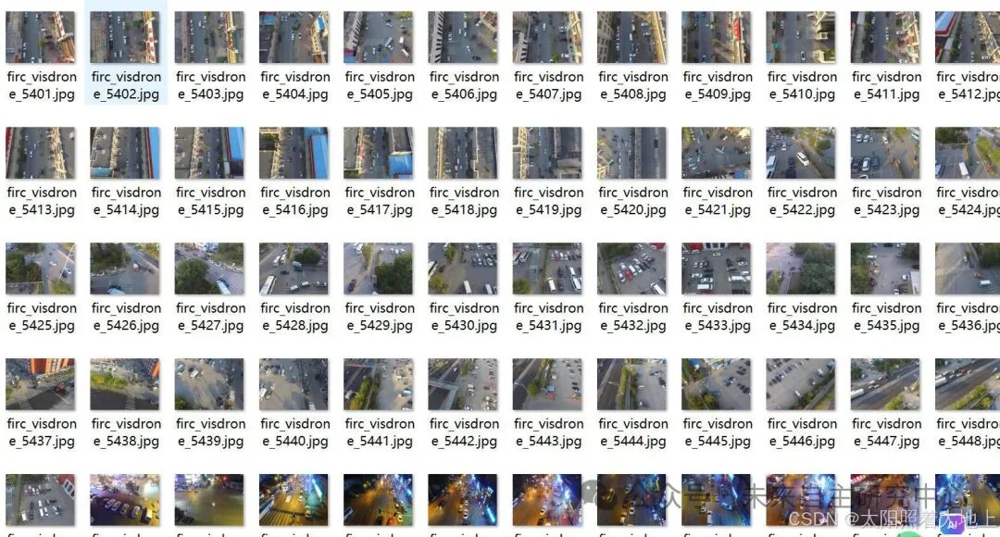
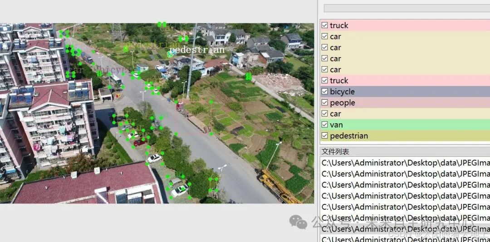

# High-altitude, long-range aerial photography of small targets for vehicle, bicycle and pedestrian detection dataset VOC+YOLO format with 8625 images across 10 categories

Important Notice: In high altitude and long-distance small target training, if the map is very low during the training process, it is considered normal. As long as the model can detect the target, it is sufficient. Sub-object detection is one of the most challenging tasks in the field of deep learning detection.

Dataset format: Pascal VOC format + YOLO format (txt files without split paths, only containing jpg images and corresponding VOC format xml files and yolo format txt files)
Number of images (jpg file count): 8625
Number of annotations (xml file count): 8625
Number of annotations (txt file count): 8625
Number of annotation categories: 10
Annotation category names: ["awning-tricycle", "bicycle", "bus", "car", "motor", "pedestrian", "people", "tricycle", "truck", "van"]
Number of bounding boxes per category:
awning-tricycle Bounding Boxes = 4374
bicycle Bounding Boxes = 13069
bus Bounding Boxes = 9117
car Bounding Boxes = 186963
motor Bounding Boxes = 40369
pedestrian Bounding Boxes = 109159
people Bounding Boxes = 38550
tricycle Bounding Boxes = 6387
truck Bounding Boxes = 16282
van Bounding Boxes = 32689
Total Bounding Boxes: 456959
Using labelImg for annotation tools
Annotation rules: Draw a box around the category
Important note: No guarantee is made regarding the accuracy or weights of the trained models or files. The dataset provides accurate and reasonable annotations only.

Image Preview:

Annotation example:

## Payment

Here is a pay link on Stripe ( https://buy.stripe.com/3cs8yP7sY87d0vu9AB ). Please contact me lonlonago@foxmail.com after funding $89, and I will send you a complete data files , thank you!

